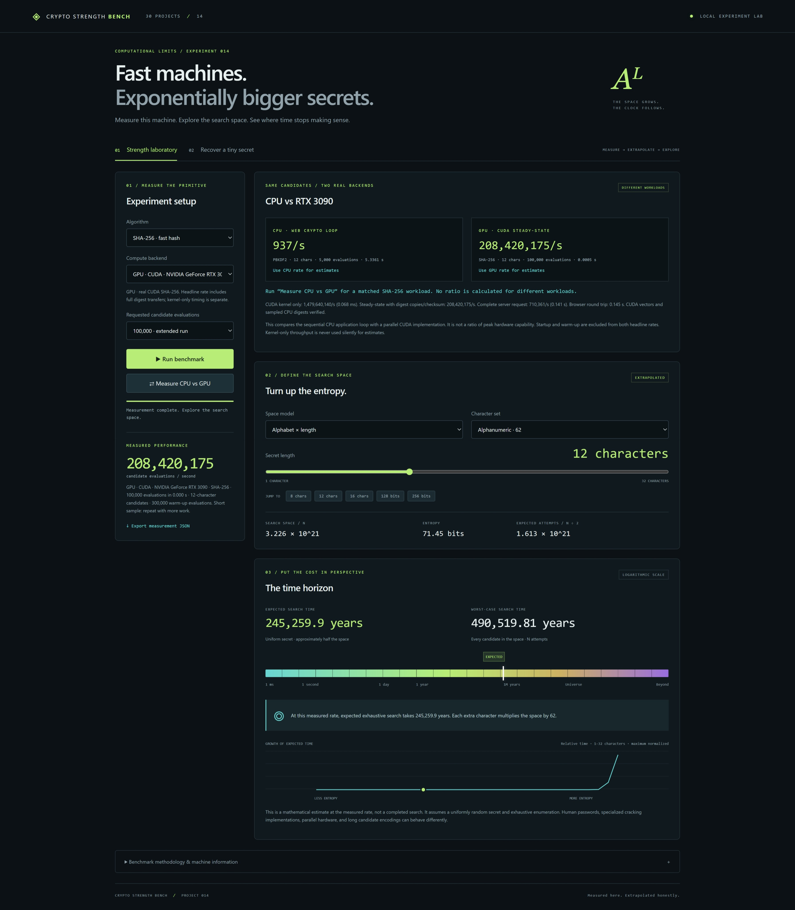

# Crypto Strength Bench

Project 14 of the 30 Projects challenge. A local visual laboratory with real CPU Web Crypto and RTX 3090 CUDA SHA-256 measurements, matched-workload comparison, exact search spaces and extrapolated time horizons. The original CPU SHA-256/PBKDF2 and recovery demo are retained.



See [CUDA setup, architecture, methodology and measured results](docs/CUDA.md) for the complete GPU addition and timing scopes.

## Launch

Requires Node.js 22+ and a current Edge, Chrome, Firefox, or Safari browser. No npm dependencies or installation step.

```powershell
cd 'C:\Users\******\Documents\ChatGPT\Project #14'
npm start
```

Open **http://127.0.0.1:4314**. The Node process serves the UI and a bounded local CUDA API on loopback. CPU experiments run in a browser worker; GPU experiments run in a native child process. There is no database or external service. Stop with Ctrl+C. Do not open index.html directly: workers and Web Crypto require localhost or HTTPS.

The CUDA binary is already built on this machine. To rebuild: `npm run build:cuda`. This reuses Project #13's toolkit without modifying it or downloading dependencies. Restart the local server if CUDA was unavailable when it started.

```powershell
npm test       # CPU/model and CUDA tests (CUDA skips only if binary absent)
npm run build  # UI + local server + CUDA binary when available into dist/
npm run bench  # bounded Node measurements; writes example-results.json
npm run bench:cuda # three paired CPU/CUDA measurements; writes cuda-results.json
```

Launch the built application with `node dist/server.mjs` (stop the source server first). Serving only static assets via localhost/HTTPS supports CPU; GPU requires the included local server/API. CUDA compilation is separate from the distribution copy; no JavaScript bundler is required.

## Demonstration

1. Select SHA-256, 1,000,000 evaluations and click **Measure CPU vs GPU**. Both implementations run sequentially using the same candidate sequence and length. Select either completed rate for extrapolation. For longer GPU samples, select GPU and 100,000,000 evaluations.
2. Select alphanumeric and move from 8 to 12 to 16 characters. Watch the expected and worst-case time estimates.
3. Jump to 128 or 256 uniform entropy bits. Hover over the search space to inspect the exact integer.
4. Switch to PBKDF2-SHA256 with 10,000 rounds and benchmark again. Estimates now use that completed measurement.
5. Open “Recover a tiny secret.” Generate a three-character secret or enter `999` with the digits alphabet. Run recovery and observe a real digest match; `999` takes all 1,000 evaluations.
6. Export JSON to retain all completed measurements from this session. Reloading clears the session. Cancellation terminates work immediately and preserves the last completed measurement.

## Architecture

- `index.html`, `style.css`, `app.mjs`: responsive laboratory interface, experiment controls, actual progress, results, JSON export, animated time ruler and growth visualization.
- `worker.mjs`: isolated browser worker, with progress/result/error messages. SHA-256 and KDF work never block the UI thread. Terminating the worker cancels either mode.
- `engine.mjs`: retained native Web Crypto CPU backend. `benchmark(options, progress)` and `recover(options, progress)` are the orchestration interface; `evaluate()` is the CPU algorithm dispatch point.
- `native/sha256.cu`, `cuda-backend.mjs`: real CUDA SHA-256 with GPU candidate generation, full digest materialization, standard vectors, CPU sampled verification, separate timing scopes, cancellation and bounded native process execution.
- `core.mjs`: exact BigInt search spaces, candidate enumeration, rejection-sampled random secrets, scientific notation, logarithmic estimates and time formatting.
- `server.mjs`, `build.mjs`: static serving/distribution and a local, origin-checked, bounded JSON CUDA API using Node built-ins. The native executable is fixed; no arbitrary shell/target hash/file API is exposed.

## Algorithms and backend

**SHA-256** produces 256-bit digests. **PBKDF2-HMAC-SHA256** derives 256 bits, using configurable 1,000–1,000,000 rounds and the fixed UTF-8 synthetic salt `Crypto Strength Bench / synthetic salt / v1`. The salt is deterministic for comparable educational runs; this is not a password-storage API.

CPU algorithms use **native Web Crypto, sequential evaluations in one worker**. Web Crypto may use native CPU instruction acceleration; no particular ISA or peak machine throughput is claimed. GPU supports **SHA-256 through CUDA** with one full digest per thread, batches up to 262,144 and 256 threads per block. PBKDF2 and the tiny recovery demo remain explicitly CPU features.

The real toolchain was found in **Project #13/.deps/cuda**, containing **nvcc 13.2.51**, and **Visual Studio 18 Community / MSVC 14.51.36231**, initialized via `VsDevCmd`. The earlier PATH/global-directory-only inspection missed this local installation. `scripts/build-cuda.cmd` discovers MSVC using `vswhere` and compiles architecture **sm_86** with static cudart. Override `CUDA_PATH` to use another toolkit. The RTX 3090 backend is compiled, measured and verified; Project #13 is reused read-only.

## Benchmark methodology

- Every evaluation creates an alphanumeric candidate, UTF-8 encodes it and evaluates the chosen primitive. For short lengths, the finite alphabet space wraps and candidates repeat; this is throughput measurement, not unique search.
- Native calls are sequential. Timing includes candidate generation, encoding, async/native call overhead, digest consumption, and throttled progress reporting. PBKDF2 includes key import and derivation. It excludes worker startup, result transfer and warm-up.
- Warm-up: 256 SHA-256 evaluations or 8 PBKDF2 evaluations. High-resolution `performance.now()` times the bounded measured loop.
- CPU requested evaluations range from 100 to 2,000,000; GPU from 100 to 100,000,000. Runs cap measured work at roughly 15 seconds (per evaluation on CPU, per batch on GPU). Initialization/warm-up can add time; cancellation terminates the CPU worker or aborts the local request and kills the CUDA process. Native requests have a 30-second process timeout.
- GPU headline rate includes candidate generation, complete SHA-256, full digest device writes, launches/synchronization, all digest D2H copies and host checksum. Startup, standard-vector tests, allocations and three warm-up batches are excluded. Kernel-only CUDA-event timing and complete server request timing are separately exposed. Neither is silently substituted for the GPU headline rate used in estimates.
- CPU vs GPU is a comparison of implementations, not peak hardware capability. A ratio is displayed only for matched algorithm/length/requested and completed counts, with a matching all-candidate checksum. Full sampled GPU digests also pass independent CPU verification. Different or capped workloads do not produce a ratio. GPU-only large counts reset to 1,000,000 when requesting a paired CPU/GPU run.
- The rate is **actual completed evaluations / actual elapsed seconds**, even if capped. Completed counts, requested counts, time, rate, algorithm, KDF parameters, candidate length, warm-up, backend, timestamp and interval-rate samples are recorded. Browser export includes user agent and logical CPU count. Browsers do not reliably expose the CPU model.
- Rates include application overhead and vary with runtime, system load, candidate length, browser, throttling and temperature. Use longer runs and repeat them. A browser run and Node run are distinct implementations of the native API and must not be treated as interchangeable or as peak hardware measurements.
- The selected algorithm controls the **next** run. Current estimates always use the **last completed** measurement described beneath the measured rate. Changing length after a run retains its throughput and assumes equal candidate cost; rerun at the new length for a more representative result. In bits mode, the benchmark uses 12-character candidates as a reference workload.

## Mathematical model and visuals

Alphabet mode deduplicates Unicode code points and computes `N = A^L` exactly with BigInt (UI lengths 1–32). Bits mode uses `N = 2^b` (UI 1–256 bits; the core supports 4,096). Worst-case attempts are N; expected attempts are approximately N/2. For a discrete uniform search without replacement the exact mean is (N+1)/2, but this project intentionally uses the requested N/2 approximation.

Time is `N/R` for worst case and `N/(2R)` for expected case. Base-10 logarithms derived from the leading 15 integer digits avoid floating-point overflow; displayed time is rounded, while the full search-space integer remains exact.

The ruler is a true fixed logarithmic seconds axis from 1 ms to 10^24 seconds. Values outside it clamp to a boundary, with “FAR BEYOND” marking upper overflow. The full estimate and universe ratio remain readable regardless of the boundary. The supplementary growth curve shows normalized relative expected time using a log1p compression to make the exponential rise visible; it is not an independently measured graph. Age of the universe is an approximate contextual reference of 13.8 billion years.

Uniformly random secrets and exhaustive enumeration are assumed. No dictionary model, guesses about human password distributions, quantum speedup, parallel hardware multiplier, or external benchmark rate is used. Entropy mode is an abstract space model, not a claim that a password’s UTF-8 encoding has that entropy.

## Controlled recovery

Only a local plaintext synthetic secret is accepted, using digits or lowercase letters with a length of 2–4. Its SHA-256 digest is generated locally, then candidates are enumerated lexicographically until a real match. The engine rejects spaces above **500,000 candidates** and invalid secrets. The demo displays the target digest, attempts/space, elapsed time, search rate and recovered secret. Progress stops at the actual match; an early match should not show 100% of the space searched.

There is no external target-hash entry, credential ingestion, remote targeting, distributed work, account attack or automation. Tiny recovery may finish before the first progress update; use a four-letter lowercase secret to observe longer progress.

## Validation and example measurements

`npm test`: **13 passing test groups**, covering the original CPU/model tests plus CUDA vectors/detection, binary full-digest parity across 14 padding lengths up to 256 bytes, all-candidate checksums, batch-boundary ordering, bounded API inputs and cancellation before/during native execution. Details and raw CPU/GPU measurements are in [docs/CUDA.md](docs/CUDA.md).

CUDA compilation and distribution build succeed. Browser smoke workflows verified CPU/GPU matched comparison, switching estimate rates, 100M GPU work, cancellation, PBKDF2 remaining CPU, recovery of `999`, input errors, export, algorithm/origin API guards and 390px mobile layout without overflow/page errors. Desktop/mobile screenshots were inspected.

This machine: **AMD Ryzen 7 9800X3D, 16 logical processors, Windows 11 (10.0.26200), NVIDIA RTX 3090**. The following table retains historical CPU-only measurements; current paired GPU results are in [docs/CUDA.md](docs/CUDA.md) and `cuda-browser-results.json`.

| Runtime / backend | Primitive | Evaluations | Elapsed | Candidate evaluations/s |
|---|---|---:|---:|---:|
| Node 24.21 native Web Crypto CPU | SHA-256, 12 chars | 100,000 | 1.488 s | 67,213 |
| Node 24.21 native Web Crypto CPU | PBKDF2, 10,000 rounds | 1,000 | 1.048 s | 954 |
| Headless Edge native Web Crypto CPU | SHA-256, 12 chars | 100,000 | ~0.337 s | 296,472 |
| Headless Edge native Web Crypto CPU | PBKDF2, 10,000 rounds | 5,000 | ~5.463 s | 915 |

These are individual observed runs, not promises or internet benchmark figures. Node records are in `example-results.json`; the latest browser smoke run exports `browser-results.json`. Repeating the smoke check overwrites that file and can produce different numbers.

For example, at the observed Edge SHA-256 rate of 296,472/s, 62^8 gives about **11.7 years expected**; 62^12 gives about **172 million years expected**; 62^16 gives about **2.55 × 10^15 years expected**. These are mathematical extrapolations at that implementation’s measured rate. No large full search was attempted.

`verify-ui.mjs` and `verify-cuda-ui.mjs` are optional developer smoke scripts using the desktop's bundled Playwright and installed Edge. With the local server running, execute `node verify-ui.mjs` and `node verify-cuda-ui.mjs`. Their module path is specific to this environment; on another machine change `createRequire` to an installed Playwright package. Playwright is not required to run/build/test the application.

## Scope and next improvements

CUDA supports SHA-256 only; PBKDF2 and recovery remain CPU. No multi-GPU selection, parallel CPU worker pool, Argon2 or persistent sessions are included. Measurements are ephemeral until exported. Next useful improvements are repeated-run statistics in the UI, a persistent CUDA process with initialization measured separately, and a batch-native CPU path for a closer implementation comparison. The original CPU worker remains available.
